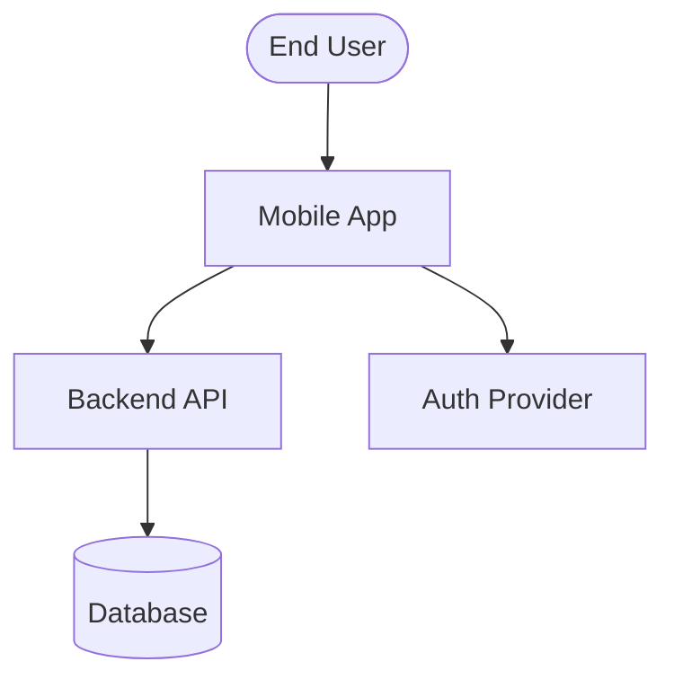
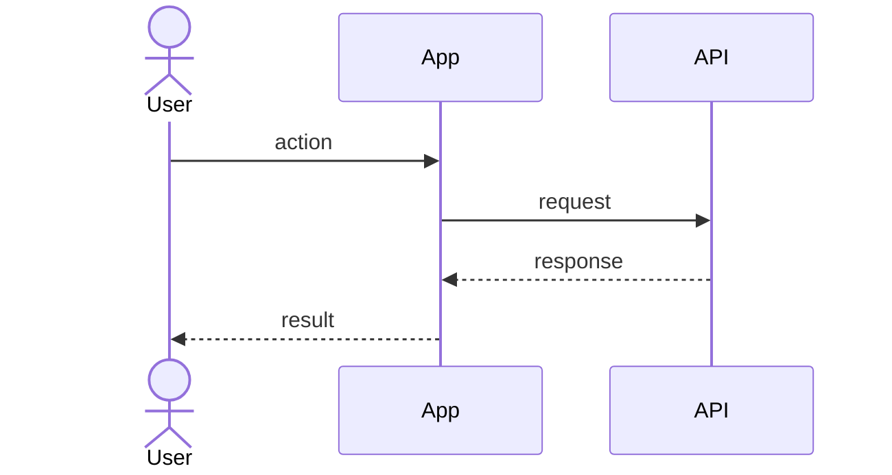
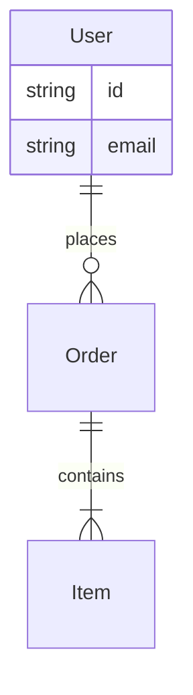
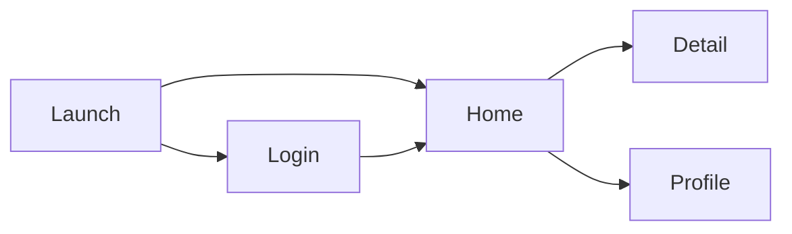

# SRS Diagram Guidelines

Guidelines for diagrams in SRS documents. Max 3-5 diagrams total per SRS.

## Rules

- Max 3-5 diagrams total per SRS
- Each diagram < 20 nodes
- Diagrams supplement text, never replace
- Conductor generates diagrams in overview step, passes to writers as context
- Section writers embed/reference only — never generate new diagrams
- Mermaid syntax only (renders in GitHub, VS Code)

## Diagram Types

### 1. System Context (C4 L1) → overview.md

Shows actors, system boundary, and external dependencies.

Use `graph TD` direction. Include: primary actors, the app as a system box, external services. Skip internal components (those go in architecture docs, not SRS).

### 2. Sequence Diagrams → functional-requirements.md

One per Must-priority core flow. Max 3-5 total.

Only cover the happy path. Keep to 5-8 steps. Name after the use case (e.g., "Login Flow", "Checkout Flow").

### 3. ER Diagram → api-contract.md

Entity relationships from OpenAPI models. Skip entirely if no OpenAPI input.

Only include entities present in the API contract. Show cardinality. Max 6-8 entities.

### 4. Screen Flow → ui-ux-requirements.md

Navigation map as a flow diagram. Skip entirely if no Figma input.

Use `graph LR` direction. Each node = one screen. Arrows = navigation triggers. Max 12 screens shown.
