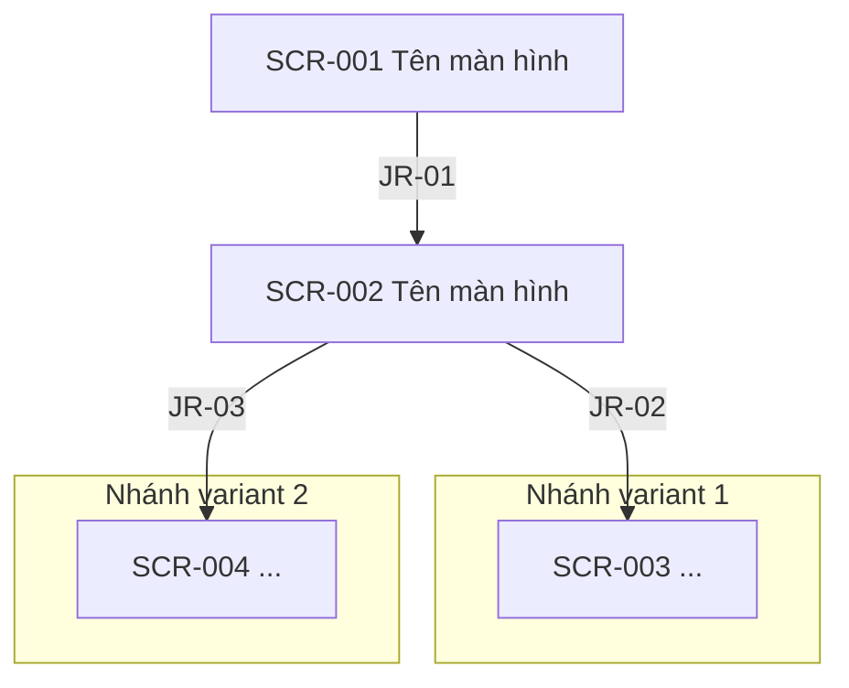

# ĐẶC TẢ YÊU CẦU PHẦN MỀM (SRS) — [TÊN TÍNH NĂNG]

# 0. THÔNG TIN TÀI LIỆU

| Mục | Nội dung |
|---|---|
| Tên tài liệu | SRS — [Tên tính năng] ([Tên app]) |
| Mã tài liệu | [PRJ]-SRS-[YYYY]-[Fxxx] |
| Phiên bản / Trạng thái | 0.1 — ☑ Dự thảo ☐ Chờ duyệt ☐ Đã phê duyệt |
| Tài liệu nguồn | URD [Fxxx] — [đường dẫn] |
| Tài liệu liên quan | Đặc tả API [mã]; Luồng chung [mã]; Thiết kế UI (Figma) [link] |

**Lịch sử sửa đổi**

| Phiên bản | Ngày | Vị trí sửa | Nội dung | Người sửa |
|---|---|---|---|---|
| 0.1 | DD/MM/YYYY | Toàn bộ | Tạo bản dự thảo đầu tiên | |

**Quy tắc chung toàn tài liệu:** Không bỏ trống ô nào — không áp dụng ghi "Không áp dụng"; chưa chốt ghi đúng dạng "Chưa chốt — ⚠️ ISS-NNN" (chi tiết tại §8). Ký hiệu: ○ = có/bắt buộc, △ = một phần/có điều kiện, × = không/ngoài phạm vi, — = không áp dụng (trong ô bảng). Phần *chữ nghiêng trong ngoặc đơn* trong các ô bảng là chú thích cho đội phát triển — KHÔNG thuộc nội dung hiển thị tới người dùng.

---

## MỤC LỤC

1. [Tổng quan](#1-tổng-quan)
2. [Thuật ngữ](#2-thuật-ngữ)
3. [Luồng tổng thể](#3-luồng-tổng-thể)
4. [Yêu cầu chức năng](#4-yêu-cầu-chức-năng)
5. [Thiết kế màn hình](#5-thiết-kế-màn-hình)
6. [Giao tiếp API](#6-giao-tiếp-api)
7. [Yêu cầu phi chức năng](#7-yêu-cầu-phi-chức-năng)
8. [Quản lý vấn đề tồn đọng](#8-quản-lý-vấn-đề-tồn-đọng)

---

# 1. TỔNG QUAN

## 1.1 Tóm tắt

| Mục | Nội dung |
|---|---|
| Mã tính năng | F-xxx |
| Tên tính năng | |
| Mục đích (user story) | Là [actor], tôi muốn [hành động], để [giá trị] |
| Người dùng | |
| Điểm vào (trigger) | [Menu/nút/deep link nào mở tính năng] |
| Điều kiện trước (phía app biết được) | [VD: đã đăng nhập; các điều kiện khác do server kiểm tra và trả lỗi] |
| Kết quả mong muốn (nhìn từ app) | [Màn hình kết quả hiển thị gì, người dùng nhận gì] |

## 1.2 Phạm vi

| Hạng mục | Phạm vi | Ghi chú |
|---|---|---|
| [Luồng màn hình chính] | ○ | |
| [Luồng chung tái sử dụng — VD xác thực OTP] | △ | Chỉ gọi; đặc tả tại tài liệu luồng chung |
| [Xử lý phía server] | × | App chỉ xử lý theo mã lỗi API trả về |

## 1.3 Luồng chung sử dụng

| Mã luồng | Tên | Phạm vi ủy thác | Tài liệu |
|---|---|---|---|
| CF-xxx | | [VD: toàn bộ nhập PIN, sinh mã, số lần thử lại] | |

---

# 2. THUẬT NGỮ

| STT | Thuật ngữ | Định nghĩa |
|---|---|---|
| 1 | | |

---

# 3. LUỒNG TỔNG THỂ

**Journey Rules**

| ID | Màn hiện tại | Điều kiện | Màn kế tiếp |
|---|---|---|---|
| JR-01 | SCR-001 | [Thao tác + API-xxx thành công (FN-xxx-001)] | SCR-002 |

---

# 4. YÊU CẦU CHỨC NĂNG

## 4.1 Danh sách chức năng

| Mã chức năng | Tên chức năng | Màn hình liên quan | API liên quan | Nguồn (URD) | Trạng thái |
|---|---|---|---|---|---|
| FN-xxx-001 | | SCR-xxx / (xử lý nền) | API-xxx-01 | | Xác định / Chờ chốt — ⚠️ ISS-NNN |

## 4.2 Đặc tả chi tiết từng chức năng

### 4.2.x FN-xxx-001: [Tên chức năng]

| Hạng mục | Nội dung |
|---|---|
| **Mô tả khái quát** | |
| **Màn hình liên quan** | SCR-xxx (hoặc "(xử lý nền)") |
| **API liên quan** | API-xxx-01 |
| **Điều kiện trước** | |
| **Điều kiện sau (thành công)** | |
| **Trigger** | |

**Luồng chính:**

| Bước | Chủ thể | Xử lý |
|---|---|---|
| 1 | KH | [Thao tác — chi tiết control xem SCR-xxx §5.3] |
| 2 | App | [Validate theo BR-xxx / gọi API-xxx-01, loading, chống double-tap] |
| 3 | App | [Thành công → chuyển SCR-yyy (JR-xx)] |

**Luồng thay thế / ngoại lệ:**

| Mã | Điều kiện phát sinh | Xử lý |
|---|---|---|
| AF-x | [Nhánh hợp lệ — VD đổi lựa chọn giữa chừng] | [Diễn biến; quay về bước n] |
| MSG-xxx-0NN | Vi phạm BR-xxx — [vế nào] / [điều kiện lỗi server] | Lỗi lớp L/S/T (hành vi: §5.5); quay về bước n |

**Quy tắc nghiệp vụ:**

| Mã rule | Nội dung | Áp dụng tại |
|---|---|---|
| BR-xxx-001 | | SCR-xxx |

**Tiêu chí chấp nhận** *(EARS)*:

- WHEN [sự kiện], App SHALL [hành vi].
- IF [điều kiện lỗi], App SHALL [hành vi] và SHALL NOT [hành vi cấm].

---

# 5. THIẾT KẾ MÀN HÌNH

## 5.1 Danh sách màn hình

| Mã màn hình | Tên màn hình | Phân loại | Chức năng liên quan | Yêu cầu đăng nhập |
|---|---|---|---|---|
| SCR-001 | | | FN-xxx-001 | ○/× |

## 5.2 Hành vi quay lại (Back)

| Màn hình | Cho phép back | Đích đến / Hành vi | Ghi chú |
|---|---|---|---|
| SCR-001 | ○ | | |
| SCR-xxx (kết quả) | × | Chặn; chỉ thoát bằng nút [X] | |

## 5.3 Định nghĩa hạng mục màn hình

**Cột "Nguồn"** — nơi lấy dữ liệu của hạng mục: API-[nhóm]-NN = server trả về; Nhập = người dùng nhập/chọn (dropdown ghi kèm nguồn danh sách trong ngoặc); Hardcode = cố định trong app; Màn trước = truyền từ màn hình trước; Tính = app tự tính theo công thức ghi trong ô; ⚠️ = chưa chốt, xem ISS đính kèm.

**Thứ tự kiểm tra đầu vào chung:** (1) bắt buộc → (2) kiểu/độ dài → (3) định dạng → (4) logic nghiệp vụ. Dừng ở lỗi đầu tiên, hiển thị message tương ứng.

**SCR-xxx: [Tên màn hình]**

| No | Tên hạng mục | Control | Bắt buộc | Độ dài | Nguồn | Giá trị mặc định | Kiểm tra đầu vào | Ghi chú |
|---|---|---|---|---|---|---|---|---|
| 1 | | | | | API-xxx-NN / Nhập / Hardcode | | | |

## 5.4 Danh mục mã và giá trị

| Mã danh mục | Dùng tại | Danh sách giá trị | Mặc định | Nguồn |
|---|---|---|---|---|
| CD-01 | SCR-xxx mục n | | | API / App / Config |

## 5.5 Danh sách thông báo & xử lý

**Chú giải cột "Lớp":** L = validate cục bộ (ở lại màn, giữ dữ liệu, focus trường lỗi); S = lỗi nghiệp vụ server; T = timeout/chưa rõ kết quả — với API giao dịch: không hiển thị "thất bại", không tự gửi lại; với API truy vấn: cho KH thao tác lại.

| Mã message | Mã server | Phân loại | Lớp | Nội dung hiển thị | Xử lý |
|---|---|---|---|---|---|
| MSG-xxx-001 | ⚠️ ISS-NNN | Lỗi (E) | S | | Ở lại màn hình hiện tại |
| MSG-xxx-098 | Mã ngoài danh sách | Lỗi (E) | S | [Message chung] *(kích hoạt khi: server trả mã ngoài danh sách hoặc lỗi kỹ thuật không có response nghiệp vụ hợp lệ — API thường)* | |
| MSG-xxx-099 | Mã ngoài danh sách | Cảnh báo (W) | T | [Message "đang xử lý"] *(kích hoạt khi: server trả mã ngoài danh sách hoặc lỗi kỹ thuật không có response nghiệp vụ hợp lệ — API giao dịch, xử lý như chưa rõ kết quả)* | |
| MSG-xxx-101 | — | Thông tin (I) | — | | — |

---

# 6. GIAO TIẾP API

## 6.1 Danh sách API

| Mã API | MID/Endpoint | Mô tả | Chức năng sử dụng | Gọi khi |
|---|---|---|---|---|
| API-xxx-01 | | | FN-xxx-001 | |

# 7. YÊU CẦU PHI CHỨC NĂNG

## 7.1 Bảo mật

| Mã | Yêu cầu | Nội dung |
|---|---|---|
| SC-01 | Chống capture màn hình | [Màn hình nào bật FLAG_SECURE / chặn screenshot] |
| SC-02 | Dữ liệu nhạy cảm | [Masking, không cache, không ghi log PII] |
| SC-03 | An toàn giao dịch | [Không retry API giao dịch; chống double-submit] |

## 7.2 Hiệu năng

| Mã | Yêu cầu | Chỉ tiêu đo được |
|---|---|---|
| PF-01 | Phản hồi thao tác gọi API | ≤ 3s hiển thị kết quả hoặc loading; timeout cứng [30s] |
| PF-02 | Chuyển màn hình trong luồng | ≤ 300ms (không gồm gọi API) |

## 7.3 Quyền (Permission)

| Quyền | iOS | Android | Dùng tại | Thời điểm xin | Khi bị từ chối |
|---|---|---|---|---|---|
| | | | | | Hướng dẫn mở Settings; không chặn chức năng khác |

## 7.4 Vòng đời và gián đoạn

| Tình huống | Hành vi |
|---|---|
| Mất mạng trước khi gọi API | |
| Mất mạng / timeout SAU khi gọi API giao dịch | [Trạng thái "đang xử lý", không hiển thị "thất bại"] |
| App xuống background / bị kill giữa luồng | [Vào lại từ đâu; dữ liệu nháp còn không] |
| Session hết hạn giữa luồng | [Theo luồng chung đăng nhập lại; quay về đâu] |
| Cuộc gọi đến / chuyển app trong màn xác thực | |
| Double-tap nút gọi API | Disable ngay sau lần nhấn đầu |

---

# 8. QUẢN LÝ VẤN ĐỀ TỒN ĐỌNG

**Lưu ý:** Không phê duyệt chính thức khi còn vấn đề mức "Cao".

| Mã | Ngày phát sinh | Nội dung vấn đề | Ảnh hưởng tới app | Mức độ | Trạng thái | Kết luận |
|---|---|---|---|---|---|---|
| ISS-001 | | | [Chặn code phần nào] | Cao/Trung/Thấp | Chưa xử lý | |
